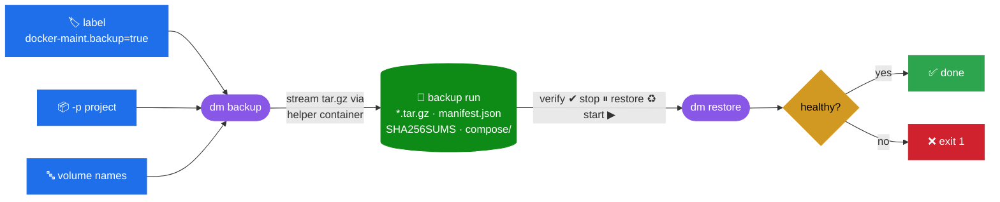

<div align="center">

# 🐳 docker-maint

**Colorful CLI toolkit for running a Docker host: backups, monitoring, documentation and compose stacks.**

[](https://github.com/BladerunnerxRC/docker-maint/actions/workflows/ci.yml)


`dm status` · `dm backup` · `dm restore` · `dm health` · `dm monitor` · `dm logs` · `dm doc` · `dm compose-*`

</div>

---

## 🚀 Quick start

```bash
git clone https://github.com/BladerunnerxRC/docker-maint.git /opt/docker-maint
sudo /opt/docker-maint/bin/dm install      # symlinks dm + dm-* into /usr/local/bin
dm                                         # list commands
dm <command> --help                        # help for one command
```

> [!NOTE]
> The tools need **bash**, **docker** and **jq**, and the compose tools also need **docker compose v2**.
> Output is colored on a terminal and plain when piped. Set `NO_COLOR=1` to turn colors off, or `FORCE_COLOR=1` to force them (for example with `less -R`).

---

## 🧰 Commands

| | Command | What it does |
|:-:|---|---|
| 🟦 | **`dm status`** | Host dashboard: engine info, disk gauge, container table (project · health · restarts · uptime · ports), `system df`, alerts |
| 🟦 | **`dm images [-u]`** | Image inventory with age coloring and "used by". `-u` compares registry digests (no pull) |
| 🟦 | **`dm cleanup [-x]`** | **Dry-run first.** Lists stopped containers, unused images/networks and build cache with sizes. Volumes are opt-in (`-v`) |
| 🟩 | **`dm backup`** | Backs up volumes chosen **by label, project or name**, with a manifest, SHA256 checksums, compose files and retention |
| 🟩 | **`dm restore`** | Verifies checksums, stops the containers using the volume, restores, restarts them and waits for health. `--as` for test restores, `--up` for deleted projects |
| 🟨 | **`dm health`** | State, healthcheck, OOM, exit codes, restart loops and policy. Exits `0` / `1` / `2` (ok / warnings / failures) for cron. `--json` available |
| 🟨 | **`dm monitor`** | Live CPU / memory / net / block dashboard with bars and thresholds. `--once`, `--sort`, `--top` |
| 🟨 | **`dm logs scan \| tail`** | Error and warning rate per container, or a colored multi-container tail (`-e` errors only, `-g REGEX`) |
| 🟪 | **`dm doc`** | Markdown inventory: host, projects, containers, port map, volumes and who uses them, bind mounts, networks, images |
| 🟥 | **`dm compose-extract`** | Reverse-engineers compose YAML from running containers, keeping only settings that differ from the image defaults. `-r` redacts secrets |
| 🟥 | **`dm compose-new`** | Scaffolds `compose.yaml` + `.env` (random secrets, mode 600) + README. Templates: `generic` `postgres` `mariadb` `redis` `nginx` `webapp` |
| 🟥 | **`dm compose-lint`** | Validates and audits compose files: `:latest` tags, hard-coded secrets, docker.sock, privileged mode, exposed DB ports, missing policies |

<sub>🟦 admin  🟩 backup  🟨 monitor  🟪 document  🟥 compose</sub>

---

## 💾 Backup & restore

### How it works



### Choose what to back up, with labels instead of hard-coded lists

```yaml
services:
  db:
    image: postgres:17-alpine
    labels:
      - docker-maint.backup=true        # back up this container's named volumes
      - docker-maint.backup.stop=true   # stop it while archiving (consistent copy)
  cache:
    labels:
      - docker-maint.backup=false       # never back this one up
```

```bash
dm backup                         # everything labelled docker-maint.backup=true
dm backup -p grafana -p jira      # every volume of these compose projects
dm backup --all --stop --keep 14  # all named volumes, stop users, keep 14 runs
dm restore --list                 # show runs
dm restore --as test_copy grafana_data   # safe test restore into a new volume
dm restore -y --up                # restore the latest run and bring back deleted projects
```

> [!TIP]
> Archives are streamed through a short-lived `busybox` container, so `dm backup` never reads
> `/var/lib/docker` directly. It works with any volume driver (including NFS), and it also works
> when `dm backup` itself runs inside a container that only has the Docker socket.

> [!CAUTION]
> `dm restore` **replaces the entire contents** of each target volume. It asks for confirmation
> unless `-y` is given. Use `--as NAME` to rehearse a restore without touching live data.

### Scheduled job (Portainer / cron)

[`docker_full_backup.yml`](docker_full_backup.yml) is a one-shot stack that runs `dm backup` against the NFS share and then exits.

```bash
# host crontab — run the job every night at 02:00
0 2 * * *  docker start -a docker-backup-job
```

| Variable | Default | Purpose |
|---|---|---|
| `BACKUP_ARGS` | `--label --stop` | Which volumes to back up (any `dm backup` selection flags) |
| `BACKUP_KEEP` | `7` | How many runs to keep |
| `DM_REPO` | `/opt/docker-maint` | Where this repo is checked out on the host |
| `DM_STACKS` | `/opt/stacks` | Compose stacks dir, mounted so compose files are saved with each run |

### Migrating from the old scripts

`backup.sh` and `restore.sh` still work. They are now thin wrappers around `dm backup` / `dm restore`:

```diff
- tar -czf "$ARCHIVE" -C /var/lib/docker/volumes/$VOL/_data .       # host path, no checksum
+ dm backup --dest /mnt/nas_backups --keep 7 comixed_data grafana_data jira_jira_data
- rm -rf "$VOL_PATH"/* && tar -xzf ... && docker stack deploy ...    # blind restore
+ dm restore -y --up      # verified, containers stopped/restarted, health-checked
```

> [!NOTE]
> Archives written by the old `backup.sh` (`<volume>_backup.tar.gz`) can still be restored:
> `dm restore --file /mnt/nas_backups/grafana_data_backup.tar.gz --volume grafana_data`.
> `restore.sh` does this automatically when it finds no new-style runs. For unattended use, set `ASSUME_YES=1`.

---

## 📊 Monitoring recipes

```bash
dm status -a                                  # full dashboard incl. stopped containers
dm health -q || notify-send "docker unhealthy" # silent unless something is wrong
dm monitor -s mem -n 10                       # top 10 by memory, refresh 5s
dm logs scan -s 7d -p grafana                 # a week of grafana errors
dm logs tail -e                               # live errors/warnings from everything
```

```cron
*/15 * * * *  /usr/local/bin/dm-health -q >> /var/log/dm-health.log 2>&1
0 6 * * 1     /usr/local/bin/dm-doc -o /mnt/nas_backups/docs/$(hostname)-$(date +\%F).md
```

---

## 🧩 Compose tooling

```bash
dm compose-extract -p jira -r -o jira/compose.yaml      # running stack → YAML (secrets redacted)
dm compose-extract --all --split ./extracted            # one compose.yaml per project
dm compose-new -t webapp -i ghcr.io/me/api:1.4 -p 8000:8000 --network proxy api
dm compose-lint .                                       # audit every compose file here
```

`compose-lint` findings carry a **rule id**. Accepted risks are suppressed *in the file itself*, where reviewers can see them:

```yaml
# dm-compose-lint: disable=docker-sock@stackback        ← one rule, one service
# dm-compose-lint: disable=no-healthcheck,no-mem-limit  ← rules for every service
```

| Severity | Meaning | Exit code |
|---|---|:-:|
| 🔴 **ERROR** | invalid file or dangerous setting | `2` |
| 🟡 **WARN** | likely problem (unpinned image, hard-coded secret, docker.sock…) | `1` |
| 🔵 **INFO** | suggestion (healthcheck, log rotation, memory limit…) | `0` |

> [!WARNING]
> `compose-extract` captures runtime configuration verbatim, **including secrets passed with `-e`**.
> Use `-r/--redact` before you commit the output anywhere.

---

## ✅ CI

Every push and pull request runs [`.github/workflows/ci.yml`](.github/workflows/ci.yml):

| Job | Checks |
|---|---|
| 🐚 **ShellCheck** | all scripts at warning level and above |
| 🧾 **Compose lint** | `dm compose-lint -q .` must report no warnings |
| 🧪 **Smoke test** | [`tests/smoke.sh`](tests/smoke.sh) runs 37 end-to-end checks against a live Docker daemon: every command, compose round trips, and backup → corrupt → restore → verify (content, ownership, checksum rejection) |

Run the same checks locally:

```bash
shellcheck -x -S warning lib/common.sh bin/* backup.sh restore.sh tests/*.sh
bin/dm-compose-lint -q .
tests/smoke.sh            # KEEP=1 to leave the test containers for inspection
```

---

## 📁 Repository layout

```text
bin/                 dm + dm-* commands
lib/common.sh        colors, tables, banners, shared helpers
lib/compose-extract.jq   inspect → compose YAML engine
restic/              Backrest + Stack-Back restic GUIs (see restic/README.md)
docker_full_backup.yml   one-shot scheduled backup job
backup.sh, restore.sh    compatibility wrappers for the old scripts
tests/smoke.sh       end-to-end test suite
```
