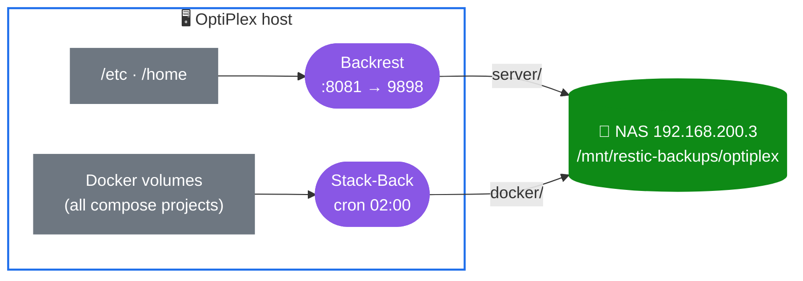

<div align="center">

# 🗄️ Restic backup GUIs

**Backrest** (server-level backups, web UI) **+ Stack-Back** (automatic Docker volume backups) in one Portainer-ready stack.


</div>



## 🟣 Backrest: server-level backups

- 🌐 Web UI at **`http://<host>:8081`** (the container listens on 9898)
- 📂 Paths to back up appear under **`/userdata`**: `/etc` → `/userdata/etc`, `/home` → `/userdata/home` (both read-only)
- 📁 Repositories live under **`/repos`**, which is the host's `/mnt/restic-backups`. Suggested repo: `/repos/optiplex/server`
- 💾 Backrest's own config, oplog and cache persist in named volumes, so they survive recreates and updates

## 🔵 Stack-Back: Docker volume backups

- 🤖 Headless. Backs up the volumes of **every compose project** (`INCLUDE_ALL_COMPOSE_PROJECTS=true`) on `CRON_SCHEDULE`
- 🗃️ Snapshots go to `/mnt/restic-backups/optiplex/docker`
- 🧹 Retention: 7 daily · 4 weekly · 12 monthly · 3 yearly
- 🏷️ Opt a container out with the label `stack-back.volumes=false`

## 🚀 Deploy

**Portainer:** Stacks → Add stack → paste `restic_gui_Docker_Stack.yaml` → **Environment variables** → add `RESTIC_PASSWORD` (see [`.env.example`](.env.example)) → Deploy.

**CLI:**

```bash
cp .env.example .env && chmod 600 .env && $EDITOR .env
docker compose -f restic_gui_Docker_Stack.yaml up -d
```

| Variable | Default | |
|---|---|---|
| `RESTIC_PASSWORD` | — | 🔴 **required**. Deployment fails fast without it |
| `TZ` | `America/New_York` | |
| `BACKREST_REPOSITORY` | `/repos/optiplex/server` | restic CLI inside the Backrest container |
| `STACKBACK_REPOSITORY` | `/mnt/restic-backups/optiplex/docker` | |
| `STACKBACK_CRON` | `0 2 * * *` | |

> [!CAUTION]
> `RESTIC_PASSWORD` encrypts the repositories. **If you lose it, the backups cannot be recovered.**
> Store it in a password manager as well as in `.env`.

> [!IMPORTANT]
> Earlier versions of this file had the password `supersecret` hard-coded, and it is still in git history.
> If any repository was initialized with it, rotate the key:
> `docker exec -it backrest restic -r /repos/optiplex/server key passwd` (and the same for the docker repository).

## 🔧 What changed from the original stack

```diff
- image: backrest/backrest:latest              # repo does not exist on Docker Hub
+ image: garethgeorge/backrest:v1.14.1
- image: ghcr.io/stackback/stackback:latest    # repo does not exist on GHCR
+ image: ghcr.io/lawndoc/stack-back:v1.5.4
- "8081:8080"                                  # Backrest listens on 9898
+ "8081:9898"
- RESTIC_PASSWORD=supersecret
+ RESTIC_PASSWORD=${RESTIC_PASSWORD:?…}        # from .env / Portainer variables
- /var/run/docker.sock:/var/run/docker.sock    # Stack-Back expects /tmp/docker.sock
+ /var/run/docker.sock:/tmp/docker.sock:ro
+ INCLUDE_ALL_COMPOSE_PROJECTS=true            # default only covers its own stack
+ backrest_data / backrest_config / backrest_cache volumes   # config survived nothing before
```

## 🌐 NFS mount

Mount the share on the host at `/mnt/restic-backups` (recommended), **or** uncomment the `restic_nfs` volume
at the bottom of the stack file to let Docker mount it directly.

> [!TIP]
> `dm compose-lint restic/` checks this stack. The Docker-socket mount Stack-Back needs is an
> accepted, documented exception (`# dm-compose-lint: disable=docker-sock@stackback`).
